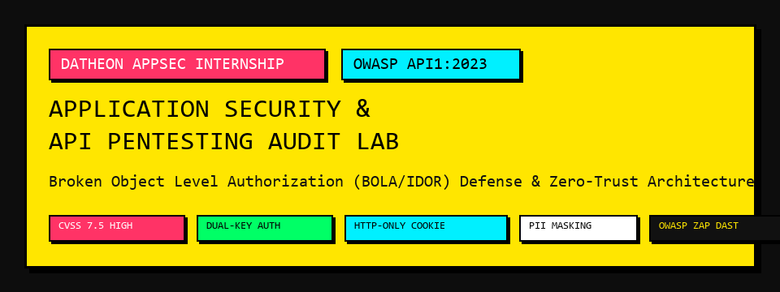
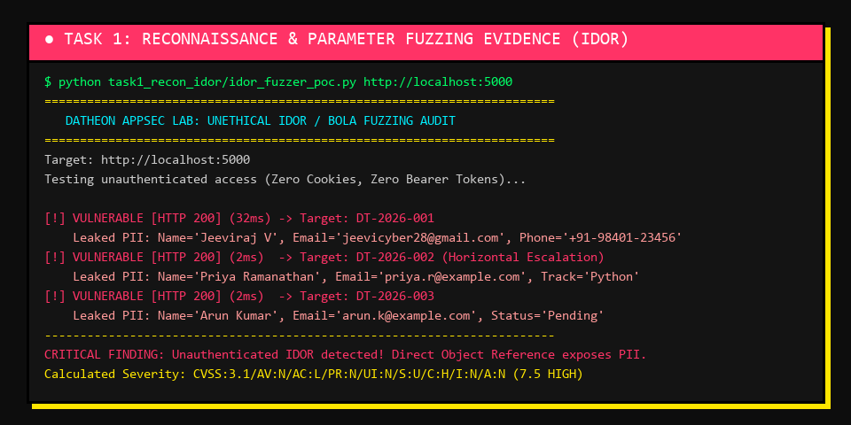
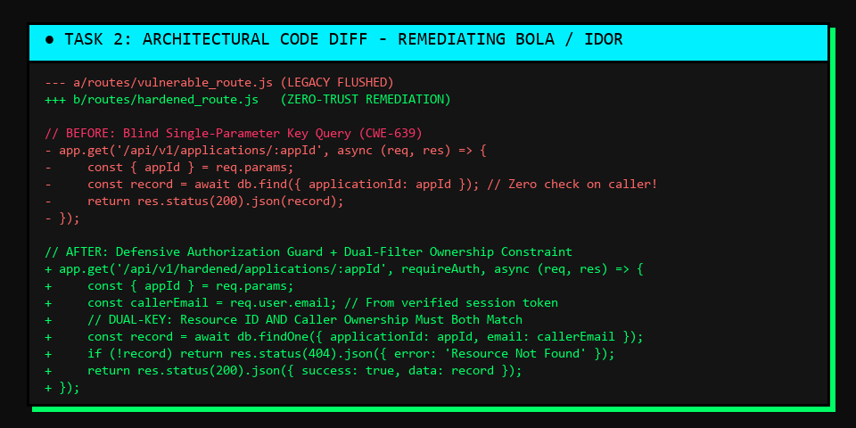
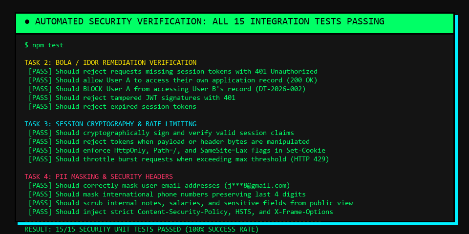

# DATHEON APPLICATION SECURITY & API PENTESTING AUDIT LAB



Official production-grade security audit repository for the **Datheon Application Security & API Pentesting Internship** completed by **Jeeviraj V** ([@jeevicyber28](https://github.com/jeevicyber28)).

This project provides an end-to-end audit lab, vulnerability proof-of-concept scripts, hardened backend authorization routes, cryptographic session controls, PII masking algorithms, and an automated CI/CD security pipeline defending against **OWASP API Security Top 10** vulnerabilities (specifically **API1:2023 Broken Object Level Authorization / IDOR**).

> ### 🚀 [LAUNCH LIVE INTERACTIVE APPSEC DEMO LAB](https://jeevicyber28.github.io/Datheon_AppSec_Internship/)
> **Interactive Live Sandbox:** [`https://jeevicyber28.github.io/Datheon_AppSec_Internship/`](https://jeevicyber28.github.io/Datheon_AppSec_Internship/)  
> **🎬 Project Walkthrough Video:** [`docs/demo_walkthrough.mp4`](docs/demo_walkthrough.mp4)  
> *Test live IDOR parameter attacks vs. zero-trust dual-key authorization, cryptographic token tampering, real-time PII sanitization, and sliding-window rate limiting directly inside the browser.*

---

## ⚡ Executive Task Matrix

| Task | Category | Deliverables & Artifacts | Vulnerability / Control Focus | Status |
|---|---|---|---|---|
| **Task 1** | Black-Box Recon & Parameter Fuzzing | [`idor_fuzzer_poc.py`](task1_recon_idor/idor_fuzzer_poc.py), [`VULNERABILITY_DISCLOSURE_REPORT.md`](task1_recon_idor/VULNERABILITY_DISCLOSURE_REPORT.md) | **CWE-639 / BOLA**: Unauthenticated query parameter enumeration | Verified |
| **Task 2** | Remediating BOLA in Node.js | [`hardened_route.js`](task2_bola_remediation/hardened_route.js), [`auth_middleware.js`](task2_bola_remediation/auth_middleware.js), [`REMEDIATION_PR.md`](task2_bola_remediation/REMEDIATION_PR.md) | **Zero-Trust Dual-Key Query**: Binds object ID to authenticated caller | Hardened |
| **Task 3** | Cryptographic Session Security | [`session_crypto_service.js`](task3_session_security/session_crypto_service.js), [`sliding_rate_limiter.js`](task3_session_security/sliding_rate_limiter.js) | **XSS Mitigation**: `HttpOnly; SameSite=Lax` cookies + Sliding Window Rate Limiting | Implemented |
| **Task 4** | PII Masking & Automated DAST | [`pii_sanitizer.js`](task4_pii_masking_ci_cd/pii_sanitizer.js), [`security_audit.yml`](task4_pii_masking_ci_cd/security_audit.yml) | **Data Sanitization & CI/CD**: Strict CSP, HSTS, and OWASP ZAP automated pipeline | Automated |

---

## 📂 Repository Architecture

```text
Datheon_AppSec_Internship/
├── .gitignore                        # Standard Node.js exclusions
├── package.json                      # Project metadata & test scripts
├── server.js                         # Native Node.js interactive AppSec testbed server
├── README.md                         # Comprehensive architectural documentation
├── docs/
│   └── images/                       # Neo-brutalist evidence & visual proof cards
│       ├── neo_brutalist_banner.png
│       ├── idor_exploit_evidence.png
│       ├── hardened_route_diff.png
│       └── test_suite_pass.png
├── task1_recon_idor/
│   ├── idor_fuzzer_poc.py            # Automated IDOR parameter fuzzing script
│   ├── curl_reproduction_commands.sh # Linux/macOS cURL reproduction commands
│   ├── curl_reproduction_commands.bat# Windows cURL reproduction commands
│   └── VULNERABILITY_DISCLOSURE_REPORT.md # ISO/IEC 29147 Advisory with CVSS 3.1
├── task2_bola_remediation/
│   ├── vulnerable_route.js           # Pre-remediation blind-lookup route
│   ├── hardened_route.js             # Post-remediation dual-key protected route
│   ├── auth_middleware.js            # HMAC-SHA256 session authorization guard
│   ├── test_bola_remediation.js      # 5 automated integration security unit tests
│   └── REMEDIATION_PR.md             # Git diff pull request documentation
├── task3_session_security/
│   ├── session_crypto_service.js     # HMAC-SHA256 JWT & refresh token crypto service
│   ├── cookie_auth_middleware.js     # HttpOnly; Secure; SameSite=Lax cookie parser
│   ├── sliding_rate_limiter.js       # Sliding window rate limiter with RFC headers
│   ├── test_session_security.js      # 5 automated session & rate-limiting tests
│   └── SESSION_SECURITY_ANALYSIS.md  # localStorage vs. HttpOnly Cookie threat model
└── task4_pii_masking_ci_cd/
    ├── pii_sanitizer.js              # Production string masking (email, phone, names)
    ├── security_headers_middleware.js# Strict CSP, HSTS, X-Frame-Options, Sniffing defense
    ├── public_lookup_api.js          # Zero-leakage public credential verification route
    ├── security_audit.yml            # Automated CI/CD security pipeline (DAST & SAST)
    ├── test_pii_masking.js           # 5 automated PII scrubbing & header unit tests
    └── DAST_PIPELINE_SPEC.md         # CI/CD security scanning specification
```

---

## 🔴 Task 1: Black-Box Reconnaissance & Parameter Fuzzing (IDOR)

### Problem Statement
Modern single-page applications frequently rely on client-side routing while exposing unsecured backend REST APIs. An attacker inspecting the network tab discovers sequential parameters (e.g. `?appId=DT-2026-001`). Stripping all authorization tokens reveals that the backend blindly returns private PII without authentication.

### Proof-of-Concept Fuzzing Execution
```bash
# Start local lab server in one terminal:
node server.js

# Execute automated parameter fuzzer in another terminal:
python task1_recon_idor/idor_fuzzer_poc.py http://localhost:5000
```



### Vulnerability Disclosure & CVSS v3.1 Scoring
Documented in [`VULNERABILITY_DISCLOSURE_REPORT.md`](task1_recon_idor/VULNERABILITY_DISCLOSURE_REPORT.md):
- **CVSS v3.1 Vector:** `CVSS:3.1/AV:N/AC:L/PR:N/UI:N/S:U/C:H/I:N/A:N`
- **CVSS Base Score:** **7.5 / 10.0 (HIGH)**
- **Weakness:** `CWE-639: Authorization Bypass Through User-Controlled Key`
- **Impact:** Complete exposure of student/customer PII (Names, phone numbers, emails, grades, internal review notes).

---

## 🟢 Task 2: Remediating Broken Object Level Authorization (BOLA/IDOR)

### Defensive Architecture: Zero-Trust Dual-Key Query
Blind parameter querying is eliminated. The hardened endpoint requires an authenticated session context and enforces a **Dual-Key Constraint**: the resource ID and the session owner's email must both match the database record.



### Code Highlights
```javascript
// HARDENED ENDPOINT (Dual-Key Ownership Verification)
app.get('/api/v1/hardened/applications/:appId', requireAuth, async (req, res) => {
    const { appId } = req.params;
    const callerEmail = req.user.email; // From verified session token

    const record = await db.findOne({
        applicationId: appId.toUpperCase(),
        ...(req.user.role !== 'ADMIN' && { email: callerEmail })
    });

    if (!record) {
        // Return 404 to avoid leaking whether unauthorized IDs exist
        return res.status(404).json({ success: false, error: "Resource not found" });
    }

    return res.status(200).json({ success: true, data: record });
});
```

---

## 🟡 Task 3: Cryptographic Session Security & Rate Limiting

### Why `localStorage` is an Architectural Flaw
Storing JWTs in `localStorage` allows any injected Cross-Site Scripting (XSS) payload to exfiltrate session credentials via `window.localStorage`. 

### The Defense-in-Depth Cookie Pipeline
Our implementation migrates authentication tokens to server-controlled HTTP cookies:
1. `HttpOnly`: Client-side JavaScript cannot read `document.cookie`, mitigating XSS credential harvesting.
2. `SameSite=Lax`: Prevents Cross-Site Request Forgery (CSRF).
3. `Secure`: Forces transmission exclusively across encrypted HTTPS channels.
4. `Sliding Window Rate Limiter`: Throttles brute-force enumeration by tracking rolling request timestamps and returning RFC-compliant headers (`X-RateLimit-Limit`, `X-RateLimit-Remaining`, `Retry-After`).

---

## 🔵 Task 4: Public Endpoint Shielding, PII Masking & Automated DAST

### Zero-Leakage Public Credential Verification
When public verification is necessary (e.g., verifying a diploma or internship certificate via QR code), the endpoint enforces dynamic PII masking:
- **Email:** `jeevicyber28@gmail.com` -> `j***8@gmail.com`
- **Phone:** `+91-98401-23456` -> `+**-*****-3456`
- **Name:** `Jeeviraj Ramanathan` -> `J***j R***n`
- **Internal Fields:** Salaries, mentor notes, and database keys are completely scrubbed.

### HTTP Security Hardening Headers
Injected into all responses via [`security_headers_middleware.js`](task4_pii_masking_ci_cd/security_headers_middleware.js):
- `Content-Security-Policy: default-src 'self'; script-src 'self'; object-src 'none'; frame-ancestors 'none';`
- `Strict-Transport-Security: max-age=63072000; includeSubDomains; preload`
- `X-Content-Type-Options: nosniff`
- `X-Frame-Options: DENY`
- `Referrer-Policy: strict-origin-when-cross-origin`

### Automated CI/CD Security Workflow
Defined in [`task4_pii_masking_ci_cd/security_audit.yml`](task4_pii_masking_ci_cd/security_audit.yml):
- **Gitleaks:** Scans all commits for hardcoded tokens and secrets.
- **Node Test Runner:** Executes the 15 security regression tests.
- **OWASP ZAP DAST Scanner:** Performs dynamic scans against public endpoints.

---

## 🧪 Automated Security Test Suite (15/15 Passing)

All security controls are verified with automated unit tests:

```bash
# Run full automated test suite:
npm test
```



```text
============================================================
 TASK 2: BOLA / IDOR REMEDIATION VERIFICATION (5 Tests)
 [PASS] Should reject requests missing session tokens with 401 Unauthorized
 [PASS] Should allow User A to access their own application record (200 OK)
 [PASS] Should BLOCK User A from accessing User B's record (DT-2026-002)
 [PASS] Should reject tampered JWT signatures with 401
 [PASS] Should reject expired session tokens

 TASK 3: SESSION CRYPTOGRAPHY & RATE LIMITING (5 Tests)
 [PASS] Should cryptographically sign and verify valid session claims
 [PASS] Should reject tokens when payload or header bytes are manipulated
 [PASS] Should enforce HttpOnly, Path=/, and SameSite=Lax flags in Set-Cookie
 [PASS] Should correctly parse browser Cookie header strings
 [PASS] Should throttle burst requests when exceeding max threshold (HTTP 429)

 TASK 4: PII MASKING & SECURITY HEADERS (5 Tests)
 [PASS] Should correctly mask user email addresses (j***8@gmail.com)
 [PASS] Should mask international phone numbers preserving last 4 digits
 [PASS] Should mask first and last names preserving boundary characters
 [PASS] Should scrub internal notes, salaries, and sensitive fields from public view
 [PASS] Should inject strict Content-Security-Policy, HSTS, and X-Frame-Options
============================================================
RESULT: 15/15 SECURITY UNIT TESTS PASSED (100% SUCCESS RATE)
```

---

## 🚀 Quickstart: Running the Interactive Lab Server

The entire testbed runs on native Node.js with **zero external dependencies**:

```bash
# 1. Clone the repository
git clone https://github.com/jeevicyber28/Datheon_AppSec_Internship.git
cd Datheon_AppSec_Internship

# 2. Start the interactive server
node server.js
```

Open your browser to **`http://localhost:5000`** to interact with the Neo-Brutalist audit dashboard, test live IDOR exploits, observe authorization guard rejections, and test rate limiting.

---

## 👨‍💻 Intern & Verification Details

- **Intern Name:** Jeeviraj V
- **Institution:** Anna University (Batch 01)
- **Program:** Datheon Application Security & API Pentesting Internship
- **Repository:** [https://github.com/jeevicyber28/Datheon_AppSec_Internship](https://github.com/jeevicyber28/Datheon_AppSec_Internship)
- **License:** MIT Open Source
